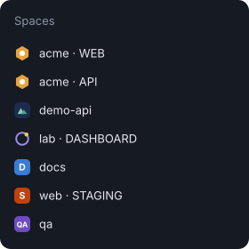

# A logo for every Herdr space

Give each space in the Herdr desktop app its own logo, or a letter tile with
the letter and color you pick, in the spaces sidebar and in the Go to picker.

## What it is

Herdr draws every space as a small tile with the first letter of its name,
so ten spaces for one client all show the same letter. This playbook maps
space names to logos in a `spaces.json` file and builds two mods that draw
them. The pattern is an anchored patch on a copy. Herdr's own `spaces` and
`picker` mods are read-only (Herdr rewrites them on every start), so a small
Python tool reads them, makes three exact edits, and writes the result as new
mods next to them. Each edit looks for one exact piece of Herdr's code, its
anchor. When a Herdr update moves that code, the tool stops and says so,
instead of writing a broken mod. That is why it is safe to run again after
every update. A space with no logo gets a letter tile: its own letter, or one
you choose, on its color, or one you choose.

## What it saved me

In my own words: "Simple UI/UX upgrades like having client icons for every
space or icons for my spaces that are working on specific projects or
dashboards has been great."

## Who it is for

People who keep many Herdr spaces open (one per client, project or
dashboard) and pick them by eye in the sidebar. Skip it if you have a few
spaces, or if you use only the terminal app `herdr`: it has no mods
(measured on `herdr` 0.9.5: its `--help` lists none), so it cannot show
pictures.

## Requirements

| Tool | Version | Check |
|---|---|---|
| Python | 3.11 or newer | `python3 --version` |
| git | any recent version | `git --version` |
| Herdr desktop app | its mods as in 0.1.15, where the anchors come from; a newer one works while `check` says the patch fits | `command -v herdr-app` |
| A Herdr home with Herdr's mods | written by the desktop app on every start | `ls ~/.config/herdr-app/mods/spaces/main.js` |
| node (optional) | any recent version, for two of the tests | `node --version` |

Herdr comes as three programs: the desktop app (`herdr-app`, the window),
the terminal app (`herdr`) and herdr-core (`hc`), which runs the terminals.
This playbook is for the desktop app. The tool itself needs only Python's
standard library.

## Quick start

### Hand it to your agent

Clone this repo, open your coding agent (Claude Code, Codex, Grok) inside the
clone, and paste this:

```text
Read PLAYBOOK.md in this repo and follow it step by step. After each step,
run its "Verify:" command and compare the result with "Expected:". If they
differ, stop and tell me what you saw. Ask me which spaces get which logo or
letter, and where my logo files are. Ask me before any step that changes
something outside this repo (my Herdr window, my Herdr home). When you finish,
run the "Done when" checks and show me their output.
```

### Do it by hand

1. See it work on made-up data: `bash examples/run.sh`.
2. Make your config:
   `mkdir -p ~/.config/herdr-space-logos/logos`, then copy
   `examples/spaces.json` there and the logos you want into `logos/`.
3. Get your space names with `herdr-app ls` and write them into
   `spaces.json`, each with `{ "logo": "file.svg" }` or
   `{ "letter": "D", "color": "#3a7bd5" }`.
4. Check it, writing nothing: `python3 src/space_logos.py check`.
5. Copy Herdr's layout: `herdr-app do layout.clone '{"name":"main","as":"logos"}'`.
6. Install: `python3 src/space_logos.py install --layout logos` (add `--keys`
   for the Go to picker too).
7. Check the mods: `herdr-app check ~/.config/herdr-app/mods/logo-spaces`
   and the same for `logo-picker`. Then look at the sidebar.

To undo: `herdr-app do layout.switch '{"name":"main"}'`, then
`python3 src/space_logos.py undo`.

## Preview

The sidebar tiles of the synthetic example (`examples/spaces.json`), drawn by
`python3 src/space_logos.py preview --config examples/spaces.json --svg examples/preview.svg`:



The output of `bash examples/run.sh`, which installs into a temporary copy of
a made-up Herdr home and undoes it:

```text
Space tiles from spaces.json (separator " · "):

  acme · WEB       logo acme.svg
  acme · API       logo acme.svg
  demo-api         logo peak.svg on #1d2b4f, 3 px margin
  lab · DASHBOARD  logo orbit.svg
  docs             letter D on #3a7bd5
  web · STAGING    letter S on #c2410c
  qa               letter QA on #6d4bc4
  any other space  letter: its first after the separator, on Herdr's color for it

Install into a copy of examples/herdr-home (a synthetic Herdr home):
Built from Herdr's shipped mods (mods/spaces, mods/picker):
  mods/logo-spaces/  main.js (3 edits), mod.json, logos/acme.svg, logos/orbit.svg, logos/peak.svg
  mods/logo-picker/  main.js (3 edits), mod.json
Layout layouts/logos.json: 1 block now uses the logo mods (backup: layouts/logos.json.bak-space-logos)
Keys keys.json: 2 keys now open logo-picker (backup: keys.json.bak-space-logos)

Undo:
  keys.json restored from its backup
  layouts/logos.json restored from its backup
  mods/logo-picker removed
  mods/logo-spaces removed
The demo home is back as it was: yes
```

## Watch out

- Logos go by the exact space name. Rename a space and it loses its logo
  until `spaces.json` has the new name and you run `install` again.
- The two mods are copies and do not follow Herdr updates. Run `install`
  again after an update. If Herdr moved the code the patch edits, it stops;
  PLAYBOOK.md says how to update the anchor.
- `--keys` edits `keys.json`. From then on Herdr treats the file as yours and
  stops adding its new default keys on upgrades. `undo` puts the original
  back.
- Only the sidebar and the picker get the tiles. Any other mod that draws
  space tiles keeps Herdr's letters.

## Files

| Path | What it is |
|---|---|
| `PLAYBOOK.md` | the steps, for an agent or a person |
| `src/space_logos.py` | the tool: `check`, `install`, `undo`, `preview`, `--demo` |
| `examples/spaces.json` | a synthetic config: seven made-up spaces |
| `examples/logos/` | three sample logos, plain generated shapes |
| `examples/herdr-home/` | a made-up Herdr home with stand-ins for Herdr's two mods, a layout and keys |
| `examples/expected-output.txt` | what `bash examples/run.sh` must print |
| `examples/preview.svg` | the picture above, made from the synthetic config |
| `tests/` | offline tests that pin the behaviour on the synthetic data |
| `check.sh` | the one gate: tests, placeholders, scrub |
| `scripts/scrub.sh` | the scrub check, copied from playbook-packaging |
| `CHANGELOG.md` | what changed, newest first |

## Credits

Made by Ormus (Ormus Solutions). It patches your own copy of Herdr's
`spaces` and `picker` mods ([Herdr](https://herdr.dev) is open source); this
repo carries none of Herdr's code beyond the few lines the patch looks for.
Packaged with playbook-packaging. MIT license.
